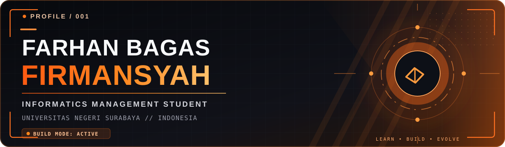
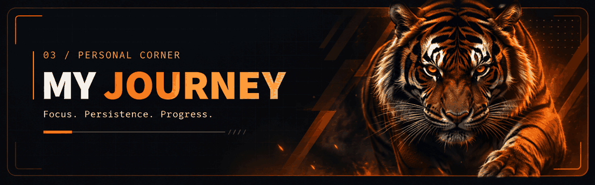
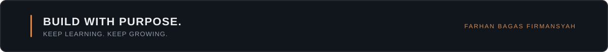

<!-- FARHAN BAGAS FIRMANSYAH | MINIMAL CYBER ORANGE × TIGER -->
<div align="center">



<br />


<p>
  
  <a href="https://github.com/Arfaynee?tab=followers"></a>
</p>

<a href="#about-me">About</a> &nbsp;·&nbsp; <a href="#github-analytics">Analytics</a> &nbsp;·&nbsp; <a href="#tiger-mode">Tiger Mode</a> &nbsp;·&nbsp; <a href="#beyond-the-code">Interests</a> &nbsp;·&nbsp; <a href="#connect">Connect</a>

</div>

---

<h2 id="about-me">01 / About Me</h2>

<table>
<tr>
<td width="61%" valign="top">

<h3>Hello, I'm Farhan 👋</h3>
<p>I'm <strong>Farhan Bagas Firmansyah</strong>, an <strong>Informatics Management</strong> student at <strong>Universitas Negeri Surabaya (UNESA)</strong>, Indonesia.</p>
<p>I'm interested in building useful digital experiences, exploring game development, and improving my programming skills one project at a time.</p>
<p><em>Stay curious. Build consistently. Improve every day.</em></p>

</td>
<td width="39%" valign="top">

<pre><code>name: Farhan Bagas Firmansyah
university: UNESA
major: Informatics Management
interests:
  - Web Development
  - Game Development
  - Gaming &amp; Automotive
status: Always learning</code></pre>

</td>
</tr>
</table>

---

<h2 id="github-analytics">02 / GitHub Analytics</h2>

<div align="center">


<br /><br />


<br /><br />


</div>

---

<h2 id="tiger-mode">03 / Tiger Mode</h2>

<div align="center">



</div>

---

<h2 id="beyond-the-code">04 / Beyond the Code</h2>

<div align="center">

<strong>Gaming</strong> &nbsp; · &nbsp; <strong>Automotive</strong> &nbsp; · &nbsp; <strong>Technology</strong>

<p>Exploring new interests, enjoying creative challenges, and always finding something new to learn.</p>

<details>
<summary>More about me</summary>
<br />

```text
[+] Learning something new
[+] Building my next idea
[+] Making steady progress
```

</details>

</div>

---

<h2 id="connect">05 / Let's Connect</h2>

<div align="center">

Want to share ideas or talk about technology? Feel free to connect.

<br /><br />

<a href="https://github.com/Arfaynee"></a>

<br /><br />



<sub>Farhan Bagas Firmansyah · UNESA · Indonesia</sub>

</div>
